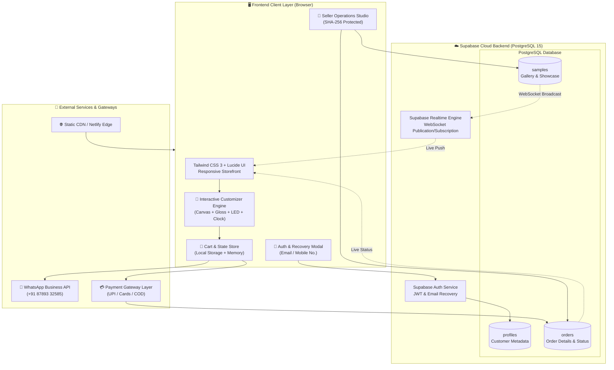
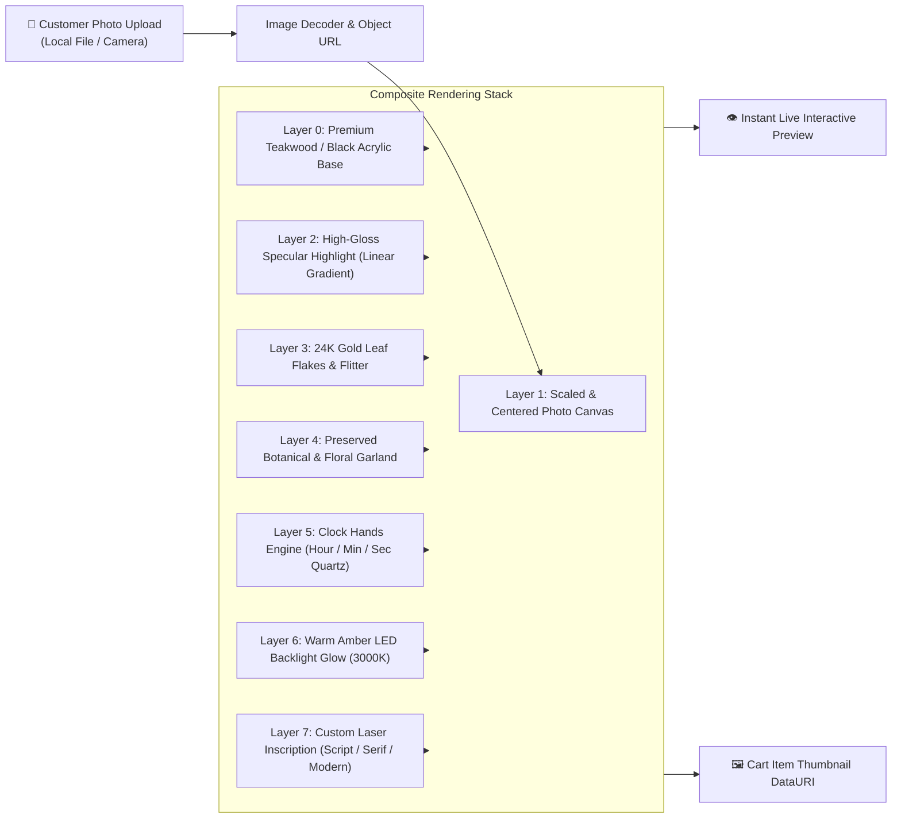
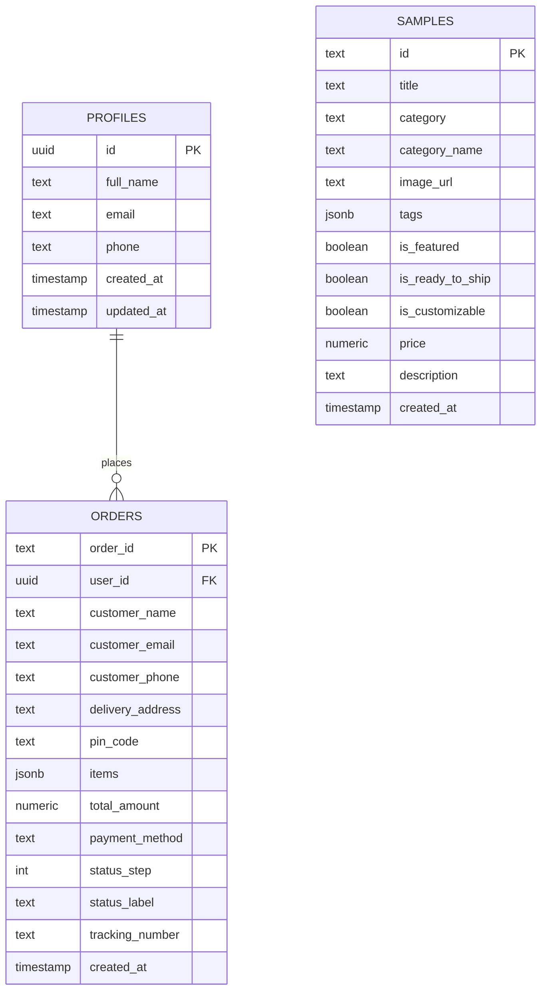
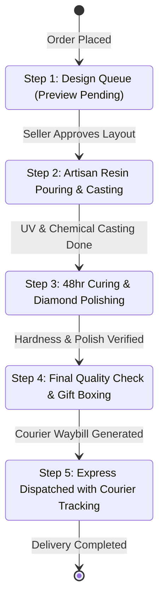
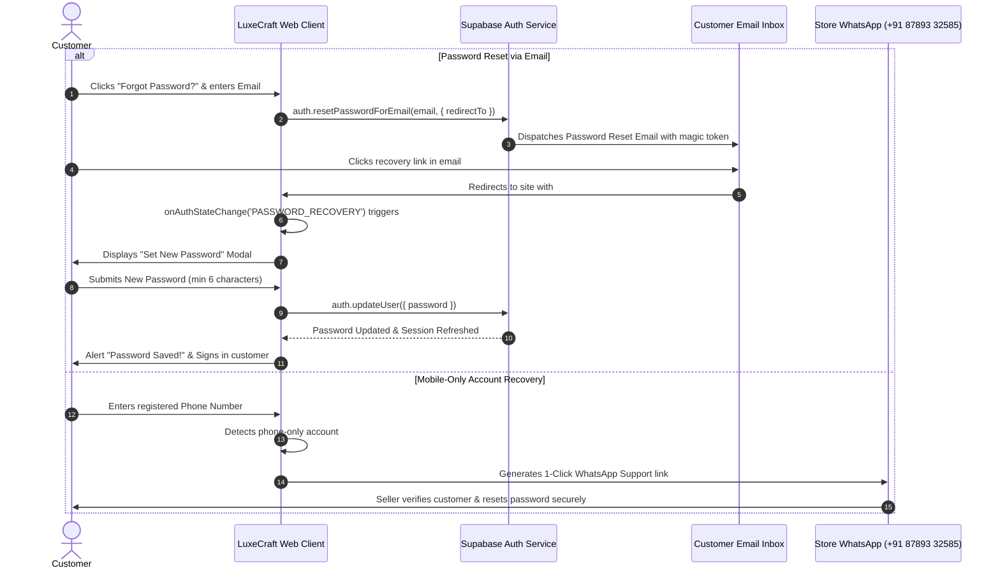
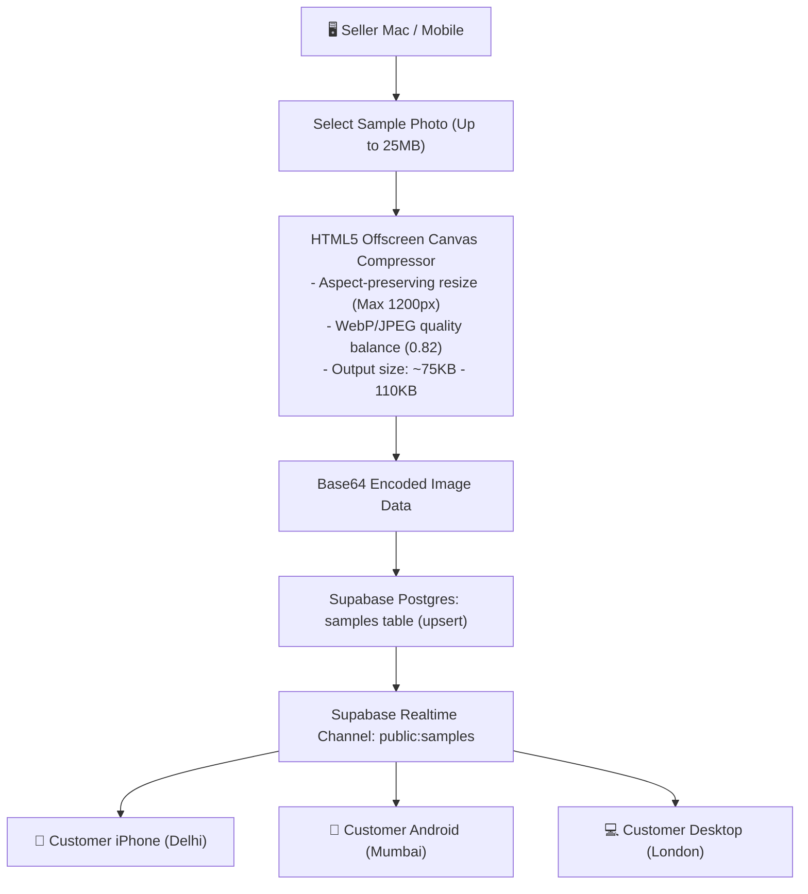

# Architecture & Technical Design Document

**LuxeCraft Studio** — Bespoke Resin Art & Photo Gifting E-Commerce Platform

---

## 1. Executive Summary & Design Philosophy

LuxeCraft Studio is an ultra-fast, zero-build, client-orchestrated e-commerce application engineered specifically for personalized resin artwork, floral keepsakes, and customized photo gifting.

### Key Architectural Tenets:
1. **Zero-Build Architecture**: Runs natively in modern web browsers without requiring Node.js bundlers (Webpack/Vite/Rollup) during runtime or deployment. Can be served from any static web server, CDN, Netlify, GitHub Pages, or Docker.
2. **Real-Time Client-Side Customizer**: Composite rendering engine utilizing HTML5 Canvas, SVG overlays, CSS transform filters, and specular lighting models for instantaneous visual feedback without server-side rendering lag.
3. **Resilient Dual-Tier Persistence**: Operates in hybrid mode — leveraging **Supabase Cloud Database (PostgreSQL 15)** for worldwide cross-device synchronization, and seamlessly falling back to browser `localStorage` for offline resilience.
4. **Dual Conversion Funnel**: Bridges automated online cart checkout with high-touch direct WhatsApp Business ordering.
5. **Real-time Bi-directional Synchronization**: Supabase WebSocket channels keep storefront galleries, customer tracking, and the seller operations studio in lockstep.

---

## 2. High-Level System Architecture

---

## 3. Interactive Photo Customizer Rendering Pipeline

The customizer mimics a 3-dimensional poured epoxy resin piece with layered physical aesthetics:

### Rendering Pipeline Mechanics:
1. **Dynamic Lighting**: CSS filters (`drop-shadow`, `box-shadow`, `hue-rotate`) emulate internal LED strip diffusion.
2. **Dynamic Inscription**: Real-time reactive data bindings update couple names and anniversary dates in selected typography:
   - *Calligraphy Script*: Handcrafted romantic flow.
   - *Luxury Serif*: High-fashion museum framing aesthetic.
   - *Modern Clean*: Minimalist contemporary look.
3. **Dynamic Clockwork**: Live mathematical calculation for quartz clock hands based on current client time or static aesthetic showcase time.

---

## 4. Database Schema & Supabase Architecture

The database runs on Supabase (PostgreSQL 15) with Row-Level Security (RLS) policies ensuring data isolation and client safety.

### Table Definitions & Purpose:
1. **`profiles`**: Stores customer identity data linked to Supabase Auth UID. Allows registration with either Email or Mobile Number.
2. **`orders`**: Contains immutable order snapshots, including item customized parameters (photo thumbnails, dimensions, LED options, inscriptions), delivery addresses, and a 5-step progression tracker.
3. **`samples`**: Global showcase gallery of seller-uploaded sample pictures. Seller uploads from Mac are compressed and saved here, enabling customers on any mobile or desktop worldwide to view them.

---

## 5. Order Lifecycle & Status Progression State Machine

Orders move through a strict 5-stage artisan manufacturing workflow managed via the Seller Studio:

---

## 6. Authentication & Password Recovery Workflow

The system provides flexible authentication: customers can register with an email address or mobile number, with integrated password reset handling:

---

## 7. Cross-Device Seller Sample Media Pipeline

To ensure photos uploaded by the seller on a Mac are accessible instantly to mobile users worldwide without exhausting database limits, images go through an in-browser optimization pipeline:

---

## 8. Security & Access Control Model

1. **Seller Operations Studio**:
   - Protected by administrative authorization passcode verified using irreversible SHA-256 cryptographic hashing.
   - Sessions are protected via cryptographic client state checks.
2. **Supabase Row-Level Security (RLS)**:
   - `samples`: Public SELECT (read), authenticated/admin upsert & delete.
   - `orders`: Public INSERT (guest checkout permitted), SELECT filtered by authenticated user UID or customer email, UPDATE restricted to admin.
   - `profiles`: SELECT & UPDATE restricted to profile owner (`auth.uid() = id`).
3. **Data Sanitization**:
   - Customer inscriptions, addresses, and order inputs are sanitized to prevent XSS.
   - Strict length constraints on couple names and messages.

---

## 9. Deployment Topologies

LuxeCraft Studio is ready for deployment across multiple infrastructure environments:

| Environment | Hosting Method | Configuration |
|---|---|---|
| **Netlify / Vercel** | Drag-and-drop or Git continuous deployment | Zero build step (`Publish directory: .`) |
| **GitHub Pages** | Static Pages Branch (`main` / `docs`) | Standard web root hosting |
| **Docker Container** | `docker-compose up` | Lightweight Nginx/Python alpine container |
| **Local Standalone** | `python3 server.py` | Built-in Python HTTP server on port 8080 |
